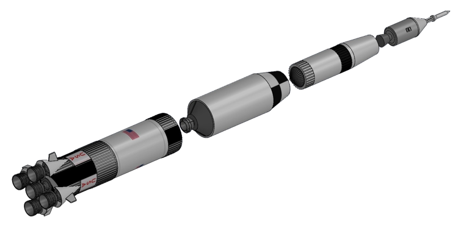
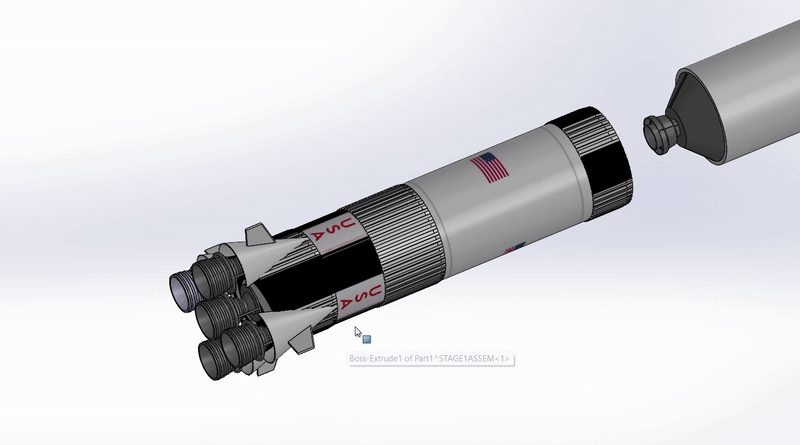
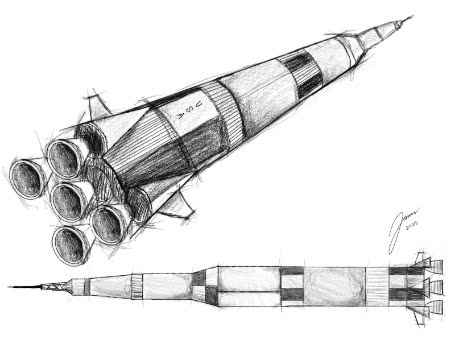
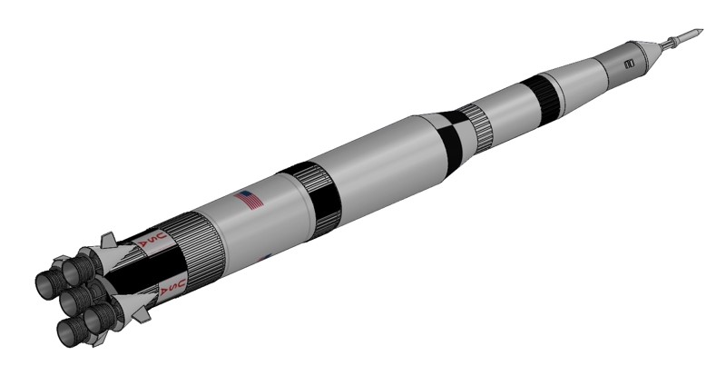

# Saturn V Rocket | 3D CAD Model

## Rocket Stages & Assembly

### Assembly Animation

**Program:** NASA L'SPACE Academy  
**Role:** Student Researcher | CAD Design

An accurately dimensioned, detailed 3D CAD model of NASA's Saturn V rocket, independently designed and modeled in its entirety by **Jensen George** during participation in the NASA L'SPACE Academy program.

## Project Overview

Developed during my participation in NASA L'SPACE Academy, this project recreates the iconic Saturn V launch vehicle in a 3D CAD environment, emphasizing geometric accuracy, dimensional consistency, and detailed representation of the rocket's external structure.

All CAD modeling was completed independently, with a focus on developing practical mechanical design and technical visualization skills.

## Original Hand-Drawn Sketch

The original conceptual sketch of the Saturn V rocket was **drawn entirely by hand by Jensen George**, serving as an initial visual reference for the subsequent 3D CAD modeling process.

## Engineering Focus

- **3D CAD Modeling:** Development of the rocket's geometry and structural features.
- **Dimensional Accuracy:** Application of reference dimensions and proportional relationships.
- **Mechanical Design:** Modeling of individual features and overall rocket geometry.
- **Technical Visualization:** Rendered images and GIFs showcasing the finished design.

## Completed CAD Model

The completed Saturn V CAD model features the assembled launch vehicle, including its individual stages, exterior geometry, and propulsion components.

## CAD Model Files

The original CAD design files are available below for further examination.

**[View Original Saturn V CAD Model](CAD/REPLACE_WITH_ACTUAL_FILENAME.SLDASM)**

## Author

**Jensen George**  
Independent CAD Design Project | NASA L'SPACE Academy
